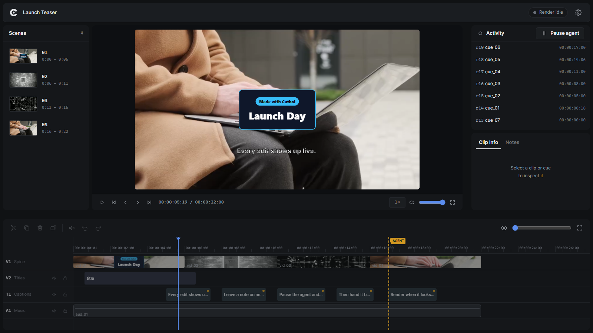
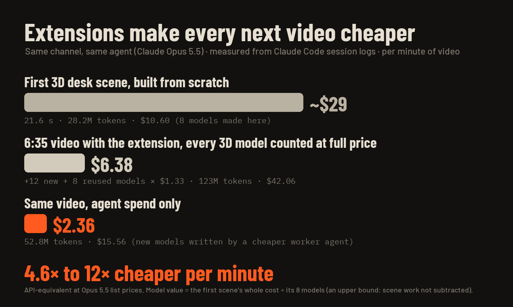
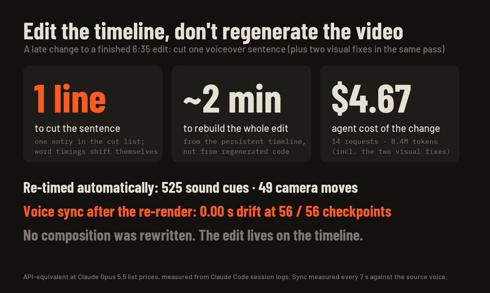
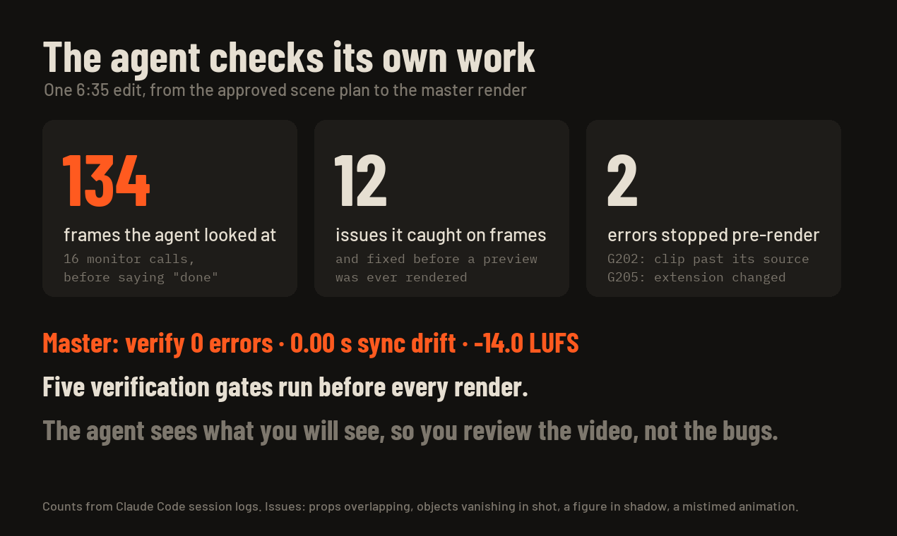
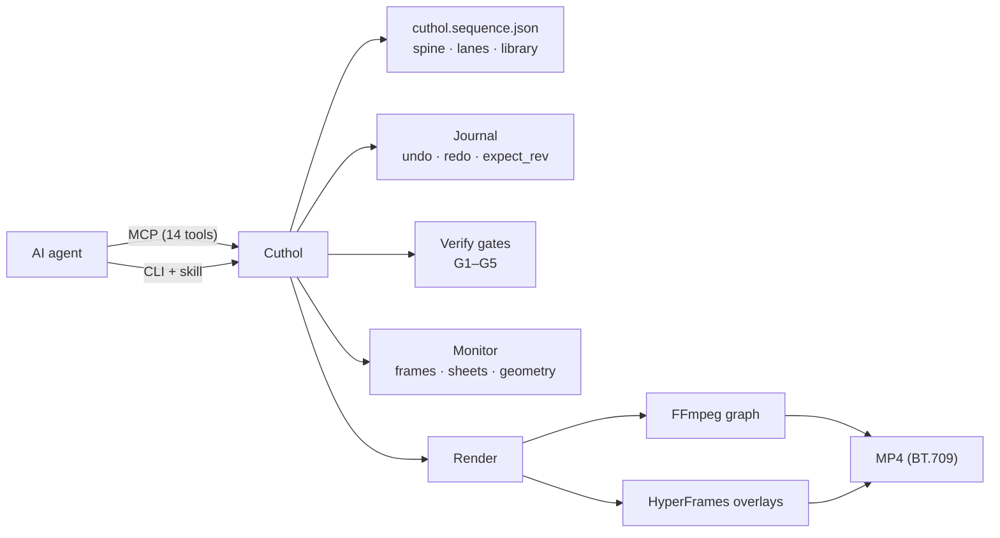

<p align="center">
  <picture>
    <source media="(prefers-color-scheme: dark)" srcset="assets/brand/cuthol-lockup-dark.png">
    
  </picture>
</p>

<h3 align="center">The video editor built for AI agents.</h3>

<p align="center">
  Your agent cuts, captions, mixes and renders video on your machine — through a CLI, an MCP server or a skill —<br>
  and checks the edit by reading text, not by guessing from pixels.
</p>

<p align="center">
  <a href="LICENSE"></a>
  
  
  
  
</p>

<p align="center">
  
</p>

<p align="center">
  <a href="#install">Install</a> ·
  <a href="#what-you-can-ask">What you can ask</a> ·
  <a href="#cuthol-live">Cuthol Live</a> ·
  <a href="#why-cuthol">Why Cuthol</a> ·
  <a href="#features">Features</a> ·
  <a href="#how-it-works">How it works</a> ·
  <a href="skills/cuthol/SKILL.md">Agent skills</a> ·
  <a href="llms.txt">llms.txt</a> ·
  <a href="src/ARCHITECTURE.md">Architecture</a>
</p>

---

## Install

```bash
npm install -g cuthol
cuthol setup            # shows which agent tools it found and what it would register
cuthol setup --apply    # registers the Cuthol MCP server with them
cuthol doctor           # checks ffmpeg 8, a Chromium browser, HyperFrames and optional speech keys
```

`cuthol setup` registers the MCP server with Claude Code (through the `claude` CLI), Codex, Cursor and Gemini CLI. It backs up every config file before writing, keeps everything else in it, and never replaces a different `cuthol` entry unless you pass `--force`. Start a new agent session afterwards; most clients read MCP servers only at session start.

No global install? `npx -y cuthol setup --apply` registers `npx -y cuthol mcp` instead.

`cuthol doctor` prints one line per check and a one-line fix for anything missing; `--json` returns the same as data, and the exit code is 1 when a required tool is missing.

<details>
<summary><strong>From source</strong></summary>

```bash
git clone https://github.com/HypeAITR/Cuthol.git cuthol
cd cuthol && npm install && npm run build
node dist/cli.js setup --apply
```
</details>

<details>
<summary><strong>Register the MCP server by hand</strong></summary>

`cuthol setup` prints the exact entry for your machine. It is a stdio server started as `node <cuthol>/dist/cli.js mcp`, where `<cuthol>` is your clone or the global install (`npm root -g` shows its folder). Use the absolute path.

- **Claude Code:** `claude mcp add cuthol -- node /absolute/path/to/cuthol/dist/cli.js mcp`
- **Codex** (`~/.codex/config.toml`):
  ```toml
  [mcp_servers.cuthol]
  command = "node"
  args = ["/absolute/path/to/cuthol/dist/cli.js", "mcp"]
  ```
- **Cursor** (`~/.cursor/mcp.json`) and **Gemini CLI** (`~/.gemini/settings.json`):
  ```json
  { "mcpServers": { "cuthol": { "command": "node", "args": ["/absolute/path/to/cuthol/dist/cli.js", "mcp"] } } }
  ```
- **Any other MCP client:** register a stdio server with the same command.
</details>

### Agent skills (installed for you)

Cuthol teaches your agent through skills: an entry skill, `cuthol`, that the agent reads at the start of a session, and category skills it loads only when the task needs them — `cuthol-editing`, `cuthol-speech`, `cuthol-audio`, `cuthol-motion`, `cuthol-geometry`, `cuthol-review`, `cuthol-render` and `cuthol-extensions`.

The first time you run any `cuthol` command, the skills are installed into every agent tool found on your machine (Claude Code, Codex, Cursor, Gemini CLI, GitHub Copilot, OpenCode and the shared `~/.agents` folder) and kept up to date afterwards; skills you edited yourself are left alone. Start a new agent session to load them. Manage them with `cuthol skills list | install | check | remove`, or set `CUTHOL_SKILLS_AUTO=0` to turn the automatic install off. Over MCP the same content is served by the `guide` tool.

**Requirements** (`cuthol doctor` checks them): Node.js ≥ 22.5, `ffmpeg` and `ffprobe` 8.x on `PATH` (`verify` and render warn with `CUTHOL-G212` on an older major), and a Chrome/Chromium that HyperFrames can launch for motion graphics (`npx hyperframes doctor`). Speech is optional: `DEEPGRAM_API_KEY` (transcription) and `ELEVENLABS_API_KEY` (voiceover) in the environment or a project `.env` — or a local model or another service through an [extension provider](examples/extensions).

## What you can ask

Once Cuthol is connected, talk to your agent the way you would brief an editor:

- *"Cut the pauses and filler words from `talk.mp4`, caption every word and put `music.mp3` under the voice."*
- *"Turn this 16:9 recording into a 9:16 short that follows the speaker."*
- *"Make a 30-second launch video with motion graphics that hit the beat."*
- *"Speed-ramp the last clip from 1× to 3× and keep the sound in sync."*
- *"Check that no title is covered or cut off before you render the master."*

The agent works through typed commands, reads the result as text, looks at real preview frames when it needs to, and every change can be undone.

## Cuthol Live

Watch your agent edit, and step in when you want to. Cuthol Live is a window on your machine that follows the edit as it happens: a preview player, the timeline with every lane, the scene list and a feed of what the agent just changed.

<p align="center">
  
</p>

- **Leave notes on the picture.** Press `N`, click the frame and write what you want changed. The agent receives the note, with the frame, alongside the result of its next command, and handles it first.
- **Pause and edit yourself.** Pause the agent and split, delete, trim, duplicate, mute or undo on the timeline. When you resume, the agent gets a summary of your changes; while it works, the edit tools stay dimmed so the two of you never edit at once.
- **See the render.** Render stages, progress and an estimate of the time left show in the window.
- **Settings in one place.** Hardware acceleration and which graphics card encodes, render workers, the output and cache folders, which browser draws the window, and keyboard shortcuts. A setting the agent changed is marked, and a change you make is passed on to the agent.

Nothing to install. By default the agent asks once at the start of a session whether to open the window; you can also open it yourself with `cuthol live open`, or set the window mode to `on` or `off` in its settings (or `CUTHOL_LIVE=on|off`). It opens in your default browser as an app window — Chrome, Edge, Brave and other Chromium browsers; others open it as a normal window — with its own profile and no extensions. Everything runs locally.

## Why Cuthol

### Every video makes the next one cheaper.

Generating a whole video as code works for a short clip. On a real production every late change means regenerating, and every new video starts from zero. Cuthol keeps the edit on a timeline and lets the agent turn what it built once — a 3D set, a caption style, a transition, a prep workflow — into an [extension](skills/cuthol-extensions/SKILL.md) it reuses next time. We measured one 6:35 video on our channel from the agent's own session logs:

<p align="center">
  
</p>

- **Extensions compound.** On the same 3D desk set, cost per minute of finished video fell from ~$29 for the first scene built from scratch to $6.38 with the extension, even counting every 3D model at full price, and to $2.36 for the agent's own spend: **4.6× to 12× cheaper per minute**.

<p align="center">
  
</p>

- **Edit, don't regenerate.** Cutting one sentence from the finished edit was a one-line change, a ~2-minute rebuild and $4.67 of agent time. 525 sound cues and 49 camera moves re-timed themselves; voice sync held at 0.00 s drift at 56 of 56 checkpoints.

<p align="center">
  
</p>

- **The agent checks its own work.** It looked at 134 frames, fixed 12 issues before a preview was ever rendered, and had 2 errors stopped by the verification gates before a render started. The master: verify 0 errors, 0.00 s sync drift, −14.0 LUFS.

<sub>Costs are API-equivalent at Claude Opus 5.5 list prices, measured from Claude Code session logs. A 3D model's value is the first scene's whole cost divided by its 8 models — an upper bound that counts against us.</sub>

### Built for how an agent works

Editing software is built around a person with a mouse and a timeline they can see. An agent has neither. Cuthol gives an agent the whole workspace of an editor in a form it can use:

- **Typed handles instead of clicks.** Every clip, cue and asset has a stable id (`vid_01`, `sp_01`, `cue_01`) that is never reused, so an agent never edits the wrong thing after a change.
- **Text views of the edit.** Compact lenses (overview, flow, canvas, detail), transcripts with word timings, and exact per-frame geometry of every motion-graphics element.
- **Images only where they help.** Frame previews and contact sheets come from the same pipeline as the final render: what the agent sees is what ships.
- **Nothing is lost.** An atomic journal with undo previews; verification gates before every render; results reported as short diffs.
- **Light on context.** The entry skill is about 10 KB; each category skill (6–9 KB) is loaded only when its task comes up. The MCP server exposes 14 tools whose schemas cost about 13k tokens once per session (measured).

## Features

| | |
|---|---|
| **Timeline** | A magnetic primary storyline (`spine`) plus typed parallel lanes (titles, captions, b-roll, motion graphics, voiceover, sfx, music). Cues anchor to clips and follow later trims. Long recordings with thousands of cuts and long compositions are normal use. |
| **Clip effects** | Applied in the render graph, so the source and its transcript binding stay intact: speed ramps that picture, audio and word timings all follow; brightness, contrast, saturation, white balance and `.cube`/`.3dl` LUTs (static or animated); per-clip effect chains; mirrored or stretched edge fill; cubic-bezier and step easing; transitions from extensions. |
| **Speech** | Transcription with word timings and automatic language detection; pause and filler cleanup whose cut edges sit in real silence and never eat a kept word; an optional post-cleanup check; repeated phrases and restarted sentences offered for review instead of cut blindly; word-highlighted captions; voiceover synthesis. |
| **Providers** | Deepgram and ElevenLabs are built in. Local models and other services plug in as extension providers — speech recognition, voiceover, and music/sound-effect sources searched and fetched into the library with their source and licence recorded. Secrets stay in the environment and are never written to the project. |
| **Mix** | Loudness normalization to a target (ITU-R BS.1770, e.g. −14 LUFS / −1 dBTP), voice polish, ducking under speech, cut alignment to a beat grid. |
| **Motion graphics** | HyperFrames compositions composited with true alpha. A runtime (`window.__cuthol`) exposes word times, beats, the beat grid and cut points — for the composition's own window and for the whole edit. Sound inside a composition (`<audio>`, audio groups, automation) enters the Cuthol mix as a per-cue stem that follows lane gain, ducking and loudness. A video can be made of motion graphics alone. |
| **Layout measurement** | Per-frame boxes of every composition element with tight glyph ink (also inside rotated or scaled containers), opacity, stacking and grouping. A one-shot geometry query reports gaps, overlaps (with rotated shapes), the element on top and distances to the frame edges — so an agent checks a layout in text. |
| **Seeing the edit** | A fast frame preview identical to the render, contact sheets in seconds, a timeline diagram, blank-frame detection, an audio health check after render, and composition script errors reported where the agent looks. |
| **Safety** | Integer-millisecond model, atomic journal with undo previews and `expect_rev`, lane locking, five verification gates (schema, assets, timing, stage, signal) with structured diagnostics, and detection of files changed outside Cuthol, shown as exact changes that can be adopted or reverted. |
| **Reframe** | Single-subject tracking when placing 16:9 footage on a 9:16 stage, with manual correction. |
| **Extensions** | Agents add their own tools without rebuilding Cuthol: composition helpers, asset packs, processors, clip effects, transitions, recipes, planners and providers. Per project or installed for every project. [Example extensions](examples/extensions) show each kind with working editing techniques: slide, wipe and flash transitions, film-look effects, freeze and fade processors, speed-ramp recipes, montage planners and a caption kit. |
| **Render** | No time limit, progress reporting, a stall watchdog, overlays cached by the data they use, parallel overlay capture, GPU encoding with a colour check (NVIDIA, AMD, Intel, VAAPI, VideoToolbox) and CPU fallback. Output is always BT.709. |

## Built on HyperFrames

[HyperFrames](https://github.com/heygen-com/hyperframes) renders HTML and GSAP into video. Cuthol is the editor around it: footage, speech, the mix, the timeline, verification and the final composite. Agents write HyperFrames compositions as usual; Cuthol feeds them the edit's timing (words, beats, cuts), places them on lanes, previews them over the real footage and composites them with alpha.

## How it works



The edit lives in one project file and changes only through Cuthol commands. Each command validates its input, applies the change atomically, runs the verification gates and returns a short result (`Changed:` / `Undo:` / diagnostics). Rendering compiles the edit into one FFmpeg graph; motion graphics are captured by HyperFrames and composited with alpha.

## Use it from the command line

```bash
node dist/cli.js workspace init ./my-video --aspect 9:16 --fps 30
node dist/cli.js library ingest talk.mp4 music.mp3 --dir ./my-video
node dist/cli.js spine append --asset vid_01 --dir ./my-video
node dist/cli.js speech transcribe --handle vid_01 --dir ./my-video
node dist/cli.js speech cleanup --dry-run --dir ./my-video
node dist/cli.js speech captions --style active_word --dir ./my-video
node dist/cli.js mix normalize --dir ./my-video
node dist/cli.js brief --lens flow --dir ./my-video
node dist/cli.js monitor sheet --grid 4x3 --dir ./my-video
node dist/cli.js verify --dir ./my-video
node dist/cli.js render --preset master_1080p --dir ./my-video
```

Each command prints a full JSON result; add `--compact` for the short text an agent sees over MCP. `node dist/cli.js help` lists every command and `help --json` prints machine-readable schemas. Over MCP, agents start with `guide(topic="overview")`.

| MCP group | Tools |
|---|---|
| Project and media | `workspace`, `library`, `brief` |
| Editing | `spine`, `lane`, `composition` |
| Speech and sound | `speech`, `mix` |
| Batch edits | `cue` |
| Checking and output | `verify`, `monitor`, `render` |
| Extensions | `extension` |
| Help | `guide` |

## Project layout

| Path | What it is |
|---|---|
| `cuthol.sequence.json` | The edit: stage, library, spine, lanes and markers. Changed only through Cuthol commands. |
| `.cuthol/journal/` | Revision snapshots for undo and redo. |
| `.cuthol/ledger.sqlite` | Cached transcripts, voiceovers and analyses (also shared per user in `~/.cuthol/cache`, so media is never paid for twice). |
| `.cuthol/blobs/` | Generated intermediates (caption files, overlays, previews). |
| `.cuthol/coords/` | Cached per-frame composition geometry. |

## Configuration

| Variable | Purpose |
|---|---|
| `CUTHOL_ASR_PROVIDER`, `CUTHOL_TTS_PROVIDER` | Default speech providers (`deepgram`, `elevenlabs`, `local`, `ext:<extension>`). |
| `CUTHOL_CACHE_DIR` | Move the user-level cache, or `0` to disable it. |
| `CUTHOL_EXTENSIONS_DIR` | Where installed extensions live, or `0` to disable them. |
| `CUTHOL_ENCODER` | `auto` (default), `nvenc`, `amf`, `qsv`, `vaapi`, `videotoolbox` or `x264`. |
| `CUTHOL_HW_ENCODER_SESSIONS` | Parallel hardware encode sessions (default 2). |
| `CUTHOL_WORKERS`, `CUTHOL_OVERLAY_CONCURRENCY` | Overlay capture parallelism (defaults from CPU cores and memory). |
| `CUTHOL_STALL_TIMEOUT_SEC` | Stop an external process that makes no progress (default 300, `0` off). |
| `CUTHOL_MCP_PROGRESSIVE`, `CUTHOL_MCP_STRUCTURED` | Progressive tool discovery; full JSON as structured content. |
| `CUTHOL_LIVE` | Cuthol Live window: `ask` (default), `on` or `off`. |

The same render, cache and window settings can be changed in the Cuthol Live settings screen or with `cuthol settings list | get | set | reset`; an environment variable always wins over a saved setting.

Rendering presets: `draft_480p` (a fast proxy for checking) and `master_1080p` (the deliverable). Diagnostics read `[CUTHOL-Gxxx] what | Suggestion: next step`.

On Windows laptops with two GPUs, the headless Chrome that captures motion graphics usually gets the integrated GPU. 3D-heavy compositions render faster after setting `chrome-headless-shell.exe` to "High performance" under Settings → System → Display → Graphics.

## Contributing

Issues and pull requests are welcome. The source map is in [`src/ARCHITECTURE.md`](src/ARCHITECTURE.md) and the working rules for coding agents in [`AGENTS.md`](AGENTS.md). Please keep changes covered by a reproducible check: a rendered frame, a diff of the render plan, or a test.

```bash
npm run build && npm test
```

`npm test` runs the suite in two stages: files that are safe to overlap in parallel, then the ones that time renders, probe hardware encoders or call paid services one at a time. Most tests make their own media with ffmpeg. A few also check larger recorded projects or real footage when they are present (`CUTHOL_TEST_FIXTURES`, `CUTHOL_TRIAL_MEDIA`), and the live speech tests run only when `DEEPGRAM_API_KEY` / `ELEVENLABS_API_KEY` are set. Anything missing is skipped with the reason, never failed.

## License

[MIT](LICENSE)
