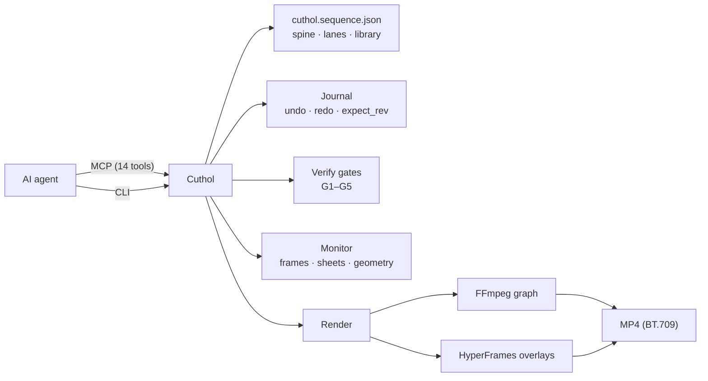

<p align="center">
  <picture>
    <source media="(prefers-color-scheme: dark)" srcset="assets/brand/cuthol-lockup-dark.png">
    
  </picture>
</p>

<p align="center">
  <strong>The video editor built for AI agents.</strong><br>
  A local, open-source non-linear editor that an agent drives through a CLI or an MCP server — and checks by reading text, not by guessing from pixels.
</p>

<p align="center">
  <a href="LICENSE"></a>
  
  
  
  
</p>

<p align="center">
  <a href="#quick-start">Quick start</a> ·
  <a href="#features">Features</a> ·
  <a href="#how-it-works">How it works</a> ·
  <a href="#use-it-from-an-agent-mcp">MCP</a> ·
  <a href="#use-it-from-the-command-line">CLI</a> ·
  <a href="skills/cuthol/SKILL.md">Agent skill</a> ·
  <a href="src/ARCHITECTURE.md">Architecture</a>
</p>

<!-- Demo loops go here (assets/demo/*.gif), e.g.:
<p align="center"> </p>
-->

---

## Why Cuthol

Editing software is built around a person with a mouse and a timeline they can see. An agent has neither. Cuthol gives an agent the whole workspace of an editor in a form it can actually use:

- **Typed handles instead of clicks.** Every clip, cue and asset has a stable id (`vid_01`, `sp_01`, `cue_01`) that is never reused, so an agent never edits the wrong thing after a change.
- **Text views of the edit.** The edit is read through compact lenses (overview, flow, canvas, detail), transcripts with word timings, and exact element geometry for every frame of a motion graphic.
- **Images only where they help.** Frame previews and contact sheets match the final render, so what the agent sees is what ships.
- **Nothing is lost.** Every change is journaled and undoable, checked by verification gates, and reported back as a short diff.
- **Motion graphics as code.** Agents write HyperFrames (HTML/GSAP) compositions that react to the words, beats and cuts of the edit.

## Features

| | |
|---|---|
| **Timeline** | A magnetic primary storyline (`spine`) plus typed parallel lanes (titles, captions, b-roll, motion graphics, voiceover, sfx, music). Cues can be anchored to clips and follow later trims. Long recordings with thousands of cuts and long compositions are normal use. |
| **Clip effects** | Applied in the render graph, so the source and its transcript binding stay intact: speed ramps that picture, audio and word timings all follow; brightness/contrast/saturation (static or animated), white balance in kelvin and `.cube`/`.3dl` LUTs; per-clip effect chains; mirrored or stretched edge fill; cubic-bezier and step easing; transitions from extensions. |
| **Speech** | Transcription with word timings; pause and filler cleanup whose cut edges sit in real silence and never eat a kept word; an optional post-cleanup check; repeated phrases and restarted sentences offered for review instead of cut blindly; word-highlighted captions; voiceover synthesis. |
| **Mix** | Loudness normalization to a target (ITU-R BS.1770, e.g. −14 LUFS / −1 dBTP), voice polish, ducking under speech, cut alignment to a beat grid. |
| **Motion graphics** | HyperFrames compositions composited with true alpha. A runtime (`window.__cuthol`) exposes word times, beats, the beat grid and cut points — for the composition's own window and for the whole edit. A video can be made of motion graphics alone. |
| **Layout measurement** | Per-frame boxes of every composition element, including tight glyph ink (also inside rotated or scaled containers), opacity, stacking and grouping. A one-shot geometry query reports, for any moment, gaps, overlaps, which element is on top and the distance to the frame edges — so an agent can check a layout in text. |
| **Seeing the edit** | A fast frame preview identical to the render, contact sheets in seconds, a timeline diagram, blank-frame detection on previews and on the rendered file. |
| **Safety** | Integer-millisecond model, atomic journal with undo previews and `expect_rev`, lane locking, five verification gates (schema, assets, timing, stage, signal) with structured diagnostics, and detection of files changed outside Cuthol (adopt as an undoable revision, or revert). |
| **Reframe** | Single-subject tracking when placing 16:9 footage on a 9:16 stage, with manual correction. |
| **Extensions** | Agents add their own tools without rebuilding Cuthol: composition helpers, asset packs, audio/video/image processors, clip effects, transitions, multi-step recipes and planners that read the edit's timing. Per project or installed for every project. |
| **Render** | No time limit, progress reporting, a stall watchdog, overlays cached by the data they actually use, parallel overlay capture, GPU encoding with a colour check (NVIDIA, AMD, Intel, VAAPI, VideoToolbox) and CPU fallback. Output is always BT.709. |

## How it works



The edit lives in one project file and is changed only through Cuthol commands. Each command validates its input, applies the change atomically, runs the verification gates and returns a short result (`Changed:` / `Undo:` / diagnostics). Rendering compiles the edit into one FFmpeg graph; motion graphics are captured by HyperFrames and composited with alpha.

## Quick start

**Requirements**

- Node.js ≥ 22.5
- `ffmpeg` and `ffprobe` on `PATH` (8.x recommended)
- A Chrome/Chromium that HyperFrames can launch (only for motion graphics; check with `npx hyperframes doctor`)
- Optional, for speech: `DEEPGRAM_API_KEY` (transcription), `ELEVENLABS_API_KEY` (voiceover)

**Install**

```bash
git clone https://github.com/HypeAITR/Cuthol.git cuthol
cd cuthol
npm install
npm run build
```

API keys can be set in the environment or in a `.env` file inside your project folder:

```
DEEPGRAM_API_KEY=...
ELEVENLABS_API_KEY=...
```

Transcripts and voiceovers are cached by content hash, in each project and in a user-level cache (`~/.cuthol/cache`), so the same media is never paid for twice.

## Use it from an agent (MCP)

Register the stdio server in your MCP client:

```json
{
  "mcpServers": {
    "cuthol": {
      "command": "node",
      "args": ["/absolute/path/to/cuthol/dist/cli.js", "mcp"]
    }
  }
}
```

Most clients read MCP servers when a session starts: after changing the configuration, start a new session and approve the `cuthol` server.

| Group | Tools |
|---|---|
| Project and media | `workspace`, `library`, `brief` |
| Editing | `spine`, `lane`, `composition` |
| Speech and sound | `speech`, `mix` |
| Batch edits | `cue` |
| Checking and output | `verify`, `monitor`, `render` |
| Extensions | `extension` |
| Help | `guide` |

Agents should start with `guide(topic="overview")`. Results come back as short text; `monitor` and `composition.preview` return images inline. Agents that support skills can load [`skills/cuthol/SKILL.md`](skills/cuthol/SKILL.md), whose references cover editing, speech and mix, compositions, verification and monitoring, extensions and MCP usage.

## Use it from the command line

```bash
node dist/cli.js workspace init ./my-video --aspect 9:16 --fps 30
node dist/cli.js library ingest talk.mp4 music.mp3 --dir ./my-video
node dist/cli.js spine append --asset vid_01 --dir ./my-video
node dist/cli.js speech transcribe --handle vid_01 --dir ./my-video
node dist/cli.js speech cleanup --dry-run --dir ./my-video
node dist/cli.js speech captions --style active_word --dir ./my-video
node dist/cli.js mix normalize --dir ./my-video
node dist/cli.js brief --lens flow --dir ./my-video
node dist/cli.js monitor sheet --grid 4x3 --dir ./my-video
node dist/cli.js verify --dir ./my-video
node dist/cli.js render --preset master_1080p --dir ./my-video
```

Each command prints a full JSON result; add `--compact` for the short text an agent sees over MCP. `node dist/cli.js help` lists every command, `help --json` prints machine-readable schemas. On the CLI relative paths resolve against the current directory; over MCP against the project folder.

## Project layout

| Path | What it is |
|---|---|
| `cuthol.sequence.json` | The edit: stage, library, spine, lanes and markers. Changed only through Cuthol commands. |
| `.cuthol/journal/` | Revision snapshots for undo and redo. |
| `.cuthol/ledger.sqlite` | Cached transcripts, voiceovers and analyses. |
| `.cuthol/blobs/` | Generated intermediates (caption files, overlays, previews). |
| `.cuthol/coords/` | Cached per-frame composition geometry. |

## Configuration

| Variable | Purpose |
|---|---|
| `CUTHOL_CACHE_DIR` | Move the user-level cache, or `0` to disable it. |
| `CUTHOL_EXTENSIONS_DIR` | Where installed extensions live, or `0` to disable them. |
| `CUTHOL_ENCODER` | `auto` (default), `nvenc`, `amf`, `qsv`, `vaapi`, `videotoolbox` or `x264`. |
| `CUTHOL_HW_ENCODER_SESSIONS` | Parallel hardware encode sessions (default 2). |
| `CUTHOL_WORKERS`, `CUTHOL_OVERLAY_CONCURRENCY` | Overlay capture parallelism (defaults from CPU cores and memory). |
| `CUTHOL_ALPHA_FORMAT` | Intermediate format for long transparent overlays. |
| `CUTHOL_STALL_TIMEOUT_SEC` | Stop an external process that makes no progress (default 300, `0` off). |
| `CUTHOL_LOCAL_TTS_CMD` | A local voiceover command instead of the cloud provider. |
| `CUTHOL_MCP_PROGRESSIVE`, `CUTHOL_MCP_STRUCTURED` | Progressive tool discovery; full JSON as structured content. |

Rendering presets: `draft_480p` (a fast proxy for checking) and `master_1080p` (the deliverable).

## Status

Cuthol is at 0.1. Editing, speech, mix, compositing, layout measurement and render are complete and have been exercised end to end by agents on real footage. Expect rough edges and breaking changes.

- Diagnostics have the form `[CUTHOL-Gxxx] what | Öneri: fix` and are currently partly in Turkish (`Öneri` means "suggestion"); English diagnostics are planned.
- HDR (PQ/HLG) sources are not tone-mapped.

## Contributing

Issues and pull requests are welcome. The source map is in [`src/ARCHITECTURE.md`](src/ARCHITECTURE.md) and the working rules for coding agents in [`AGENTS.md`](AGENTS.md). Please keep changes covered by a reproducible check (a rendered frame, a diff of the render plan, or a test).

## License

[MIT](LICENSE)
